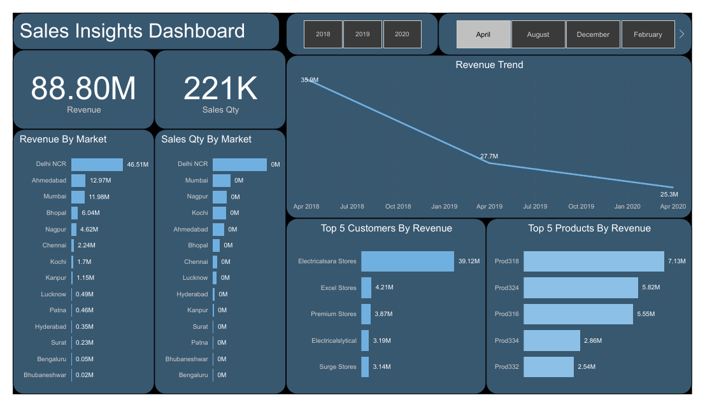

# Sales Insights Dashboard

Revenue and sales-quantity dashboard by market, customer and product (2018-2020), built on a MySQL dump.

## What it shows
- Revenue trend, revenue and quantity by market
- Top 5 customers and products by revenue
- Source data loaded from a SQL database dump (db_dump.sql)

## Files
- `sales Insights dashboard.pbix`: Power BI report (open in Power BI Desktop)
- `sales Insights dashboard.pdf`: exported PDF of the report
- `data/`: source data. db_dump.sql (included, about 9 MB).

## Tools
Power BI, DAX, Power Query.

## Author
Asad Ullah, Data Analyst and Power BI Developer, Dammam, Saudi Arabia
[LinkedIn](https://linkedin.com/in/asadullah44) | [Portfolio](https://asadullah-the-analyst.netlify.app) | [GitHub](https://github.com/asadullah43)
